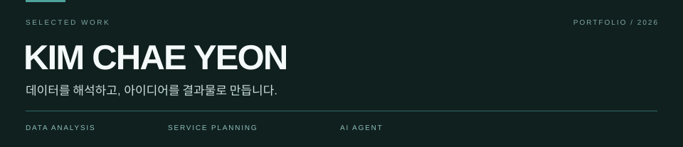
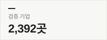
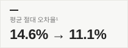
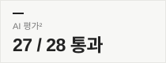
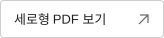
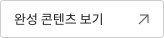
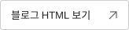

 

### 회사 연봉 AI
국민연금 데이터로 연봉을 추정하고, 실제 공시 급여로 검증한 회사 탐색 서비스.

&nbsp;

&nbsp;

Python · SQL · Streamlit · Gemini · MCP

---

### 제로이드 × 무신사 뷰티
브랜드 분석과 꿈돌이 협업 아이디어를 담은 무신사 뷰티 입점 제안서.

&nbsp;

브랜드 분석 · 입점 기획 · 제안서 디자인

---

### 솔트웨어 인사이트
리서치·글쓰기·이미지 제작을 분담한 AI 에이전트 팀과 블로그 콘텐츠 **12편**.

&nbsp;

콘텐츠 기획 · SEO · AI 에이전트

---

¹ 5겹 교차검증의 평균 절대 오차율이며, 서비스에는 별도 혼합 보정을 적용합니다. ² 28문항을 한 번씩 실행한 결과입니다. 
연봉 AI의 AI 기능은 비밀번호가 필요할 수 있습니다. 제안서·블로그는 학습용 비공식 시안입니다.
