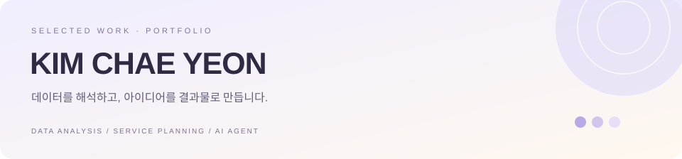

  

 

### 01 &nbsp; 회사 연봉 AI
국민연금 데이터로 연봉을 추정하고, 실제 공시 급여로 검증한 회사 탐색 서비스.

| 검증 기업 | 추정 오차¹ | AI 평가² |
| :---: | :---: | :---: |
| **2,392곳** | **14.6% → 11.1%** | **27/28 통과** |

[분석 과정과 성과](https://github.com/codus1111/pension-salary#readme) &nbsp; · &nbsp; [결과 차트](https://github.com/codus1111/pension-salary/tree/main/reports/figures)

Python · SQL · Streamlit · Gemini · MCP

---

### 02 &nbsp; 제로이드 × 무신사 뷰티
브랜드 분석과 꿈돌이 협업 아이디어를 담은 무신사 뷰티 입점 제안서.

[가로형 PDF 보기](https://github.com/codus1111/daejeon_01/blob/main/codus1111/zeroid-가로형/제로이드_무신사_입점제안서_가로형.pdf)

브랜드 분석 · 입점 기획 · 제안서 디자인

---

### 03 &nbsp; 솔트웨어 인사이트
리서치부터 글쓰기·이미지·조립까지, AI 에이전트 팀으로 제작한 블로그 콘텐츠 **12편**.

[블로그 시안 HTML](https://github.com/codus1111/daejeon_01/blob/main/codus1111/saltware-blog/index.html)

콘텐츠 기획 · SEO · AI 에이전트

---

¹ 5겹 교차검증의 평균 절대 오차율. 서비스에는 별도 혼합 보정을 적용합니다. ² 28문항을 한 번씩 실행한 평가. 
연봉 AI의 AI 기능은 비밀번호가 필요할 수 있습니다. 제안서·블로그는 학습용 비공식 시안이며, HTML은 내려받아 브라우저에서 열 수 있습니다.
