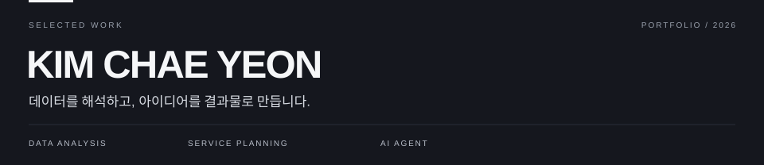
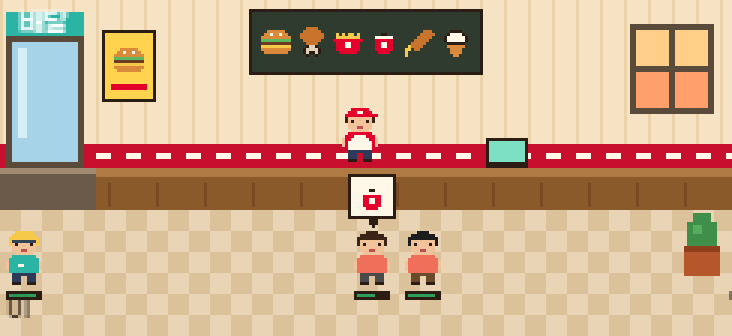
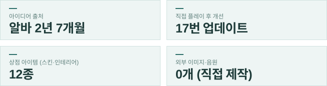
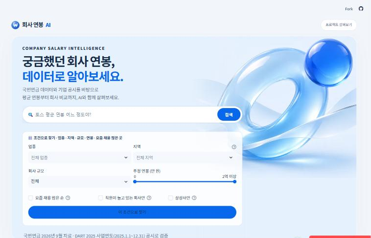
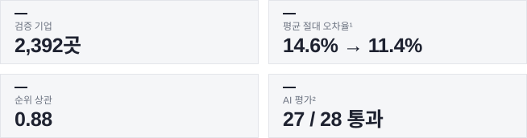
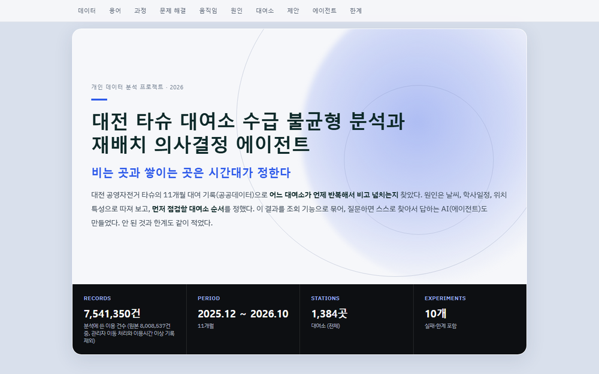
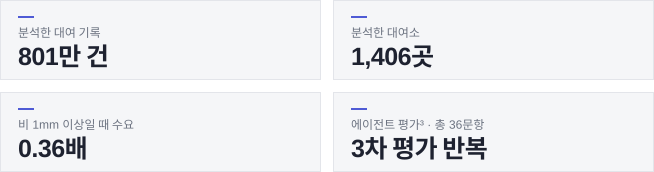

 

### 햄부기 러시
패스트푸드 매장 알바 경험으로 기획하고 AI(Claude Code)와 함께 만든 도트 피크타임 게임. 매장과 배달이 동시에 몰리는 피크타임과 **품절 주문 처리**를 게임 규칙으로 옮겼고, 플레이 피드백을 받아 **20번 업데이트**하며 다듬었습니다. [게임 설명](hamburgi-rush/README.md) · [개발 로그](hamburgi-rush/DEVLOG.md)

&nbsp;

&nbsp;

     

---

### 회사 연봉 AI
국민연금 데이터로 연봉을 추정하고, 실제 공시 급여로 검증한 회사 탐색 서비스.

&nbsp;

&nbsp;

    

---

### 타슈 수급 불균형 분석
대전 공영자전거 대여 기록으로 대여소가 언제 비고 넘치는지 찾고, 점검 우선순위와 질의응답 에이전트까지 만든 분석.

&nbsp;

&nbsp;

    

---

### 솔트웨어 인사이트
리서치·글쓰기·이미지 제작을 분담한 AI 에이전트 팀과 블로그 콘텐츠 **12편**. [프로젝트 설명](saltware-blog/README.md)

&nbsp;

  

---

### 클로드 코드 스킬
직접 만든 스킬을 종류별로 모았습니다. 종류를 눌러 펼쳐 보세요. 전체 안내는 [스킬 폴더](https://github.com/codus1111/codus1111/tree/main/claude-skills)에 있습니다.

<strong>기획 · 리서치</strong> &nbsp;(1)

| 스킬 | 하는 일 | 이럴 때 | 바로 보기 |
| :--- | :--- | :--- | :--- |
| **persona-analysis** | 프로젝트 설명으로 가상 페르소나 5개를 만들고 대표 3개를 상세 분석 · 리포트(md) + 카드(HTML) | "페르소나 만들어줘", 타깃 고객 정리 | [SKILL.md](https://github.com/codus1111/codus1111/blob/main/claude-skills/planning/persona-analysis/SKILL.md) · [결과 예시](https://github.com/codus1111/codus1111/tree/main/claude-skills/planning/persona-analysis/examples) · [.skill 파일](https://github.com/codus1111/codus1111/blob/main/claude-skills/planning/persona-analysis.skill) |

<strong>법무 · 컴플라이언스</strong> &nbsp;(1)

| 스킬 | 하는 일 | 이럴 때 | 바로 보기 |
| :--- | :--- | :--- | :--- |
| **project-legal-guard** | 데이터 프로젝트의 법령·약관을 조사해 `COMPLIANCE.md`로 정리하고 `CLAUDE.md`에 연결, 진행 중 계속 상기 | 새 데이터·외부 API 사용, 결과 공개 전 | [SKILL.md](https://github.com/codus1111/codus1111/blob/main/claude-skills/compliance/project-legal-guard/SKILL.md) · [적용 예시(타슈 프로젝트)](https://github.com/codus1111/codus1111/blob/main/claude-skills/compliance/project-legal-guard/examples/tashu-project-recheck.md) · [템플릿](https://github.com/codus1111/codus1111/blob/main/claude-skills/compliance/project-legal-guard/assets/COMPLIANCE-template.md) |

<strong>자동 규칙 · 훅</strong> &nbsp;(스킬은 아니고 함께 쓰는 장치)

| 이름 | 하는 일 | 바로 보기 |
| :--- | :--- | :--- |
| **준수 상기 · 위반 차단 훅** | 세션 시작과 매 입력마다 규칙을 다시 알려주고, 키·데이터 파일 커밋·스크래핑 도구 사용을 막음 | [타슈 프로젝트 훅](https://github.com/codus1111/codus1111/tree/main/tashu-rebalancing/.claude/hooks) |

   
페르소나는 가상이며 실제 조사 데이터가 아닙니다. 법무 스킬은 법률 자문이 아닙니다.

---

¹ 5겹 교차검증의 평균 절대 오차율이며, 서비스에는 별도 혼합 보정을 적용합니다. ² 28문항을 한 번씩 실행한 결과입니다. ³ 질문 9·15·12개로 세 번 평가하며 2차에서 찾은 문제를 고쳤습니다. 각 1회 실행이고 3차는 고친 문제를 겨냥한 질문이라 일반화는 어렵습니다. 
연봉 AI의 AI 기능은 비밀번호가 필요할 수 있습니다. 블로그는 학습용 비공식 시안입니다. 햄부기 러시는 개인 학습 프로젝트로 특정 패스트푸드 브랜드와 무관하며, 메뉴 가격은 대략적인 참고값입니다. 타슈 분석은 개인 학습 프로젝트이며 대전교통공사·대전광역시와 무관합니다. 출처: 대전교통공사 타슈 대여이력(공공데이터포털), Weather data by Open-Meteo.com (CC BY 4.0). 대여소 재고는 알 수 없어 순유출 압력으로 추정했습니다.

---

<b>개인 포트폴리오입니다.</b> 이 저장소의 프로젝트는 개인 학습용이며, 언급된 기업·기관(솔트웨어, 대전교통공사·대전광역시 등)과 제휴·후원·고용 관계가 없습니다. 상표와 서비스 이름은 각 소유자의 것입니다.

