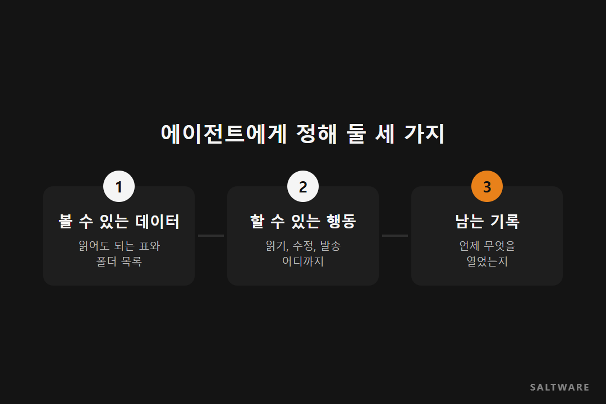
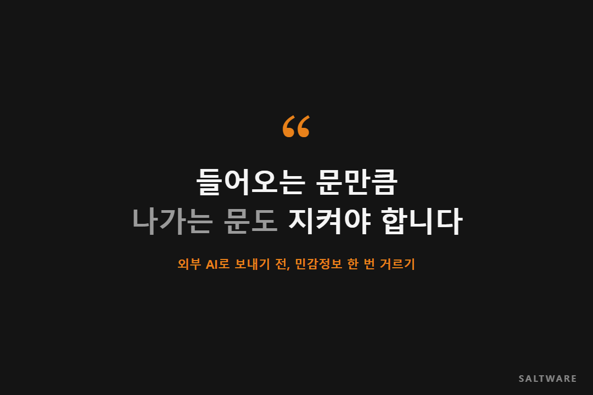

신입사원이 첫 출근을 하면 회사는 사원증부터 만들어 줍니다. 그런데 그 사원증으로 열리는 문은 정해져 있습니다. 사무실은 열리지만 서버실은 안 열리고, 인사팀 캐비닛도 안 열리죠. 아무도 이걸 이상하게 생각하지 않습니다.

AI 에이전트를 들일 때는 이 당연한 절차가 자주 빠집니다. 빨리 써 보고 싶은 마음에 관리자 계정 하나를 통째로 연결해 두는 경우가 적지 않습니다.

**에이전트도 직원처럼 어디까지 열 수 있는지를 먼저 정해 줘야 합니다.** 이번 [데이터 노트]는 AI 에이전트 권한 관리 이야기입니다.

## 에이전트는 묻지 않고 그냥 엽니다

사람 직원은 애매하면 물어봅니다. "이 파일 제가 봐도 되나요?" 에이전트는 다릅니다. 연결된 권한 안에 있으면 일을 빨리 끝내려고 그냥 엽니다.

매출 보고서를 만들라고 했을 뿐인데 급여 테이블까지 같이 읽어서 인건비 비중을 친절하게 덧붙여 줄 수도 있습니다. 악의가 있어서가 아니라 열려 있었기 때문이죠.

## AI 에이전트 권한 관리, 정해 둘 것은 세 가지입니다

복잡해 보여도 결국 사람 직원에게 하던 걸 그대로 옮기면 됩니다.

첫째는 볼 수 있는 데이터입니다. 이 에이전트가 읽어도 되는 테이블과 폴더를 목록으로 정합니다. 둘째는 할 수 있는 행동입니다. 읽기만 하는지, 수정까지 하는지, 메일을 보내는 것까지 되는지를 나눠 둡니다. 셋째는 남는 기록입니다. 언제 무엇을 열어 봤는지 나중에 확인할 수 있어야 합니다.

## 밖으로 나가는 문도 있습니다

권한 이야기는 보통 회사 안쪽만 봅니다. 그런데 에이전트가 외부 AI 모델을 부르는 순간, 회사 데이터가 질문에 실려 밖으로 나갑니다.

고객 이름, 주민등록번호, 계약 금액이 그대로 실려 나가지 않도록 나가기 전에 한 번 걸러 주는 단계가 필요합니다. 들어오는 문만큼 나가는 문도 지켜야 하는 셈입니다.

## 솔트웨어가 고객사와 일하며 보는 것

솔트웨어는 SailPoint 공식 파트너로서 계정과 권한을 관리하는 아이덴티티 거버넌스(IGA)의 도입과 구축을 맡고 있습니다. 또 프롬프트와 첨부 파일이 외부 AI에 닿기 전에 민감정보를 찾아 가리거나 막는 Sapie-Guardian도 제공합니다.

## 정리하며

에이전트는 빠르고 성실하지만 눈치는 없습니다. 그래서 처음부터 열어 줄 문과 닫아 둘 문을 정해 줘야 합니다. 볼 수 있는 것, 할 수 있는 것, 남는 기록. 이 세 가지만 정해 둬도 큰 사고는 상당 부분 막을 수 있습니다.

다음 [데이터 노트]에서는 에이전트가 남긴 기록을 어떻게 읽고 점검하는지 다루겠습니다.

#AI에이전트 #권한관리 #생성형AI보안 #민감정보 #솔트웨어

참고한 자료
- 솔트웨어 홈페이지, SailPoint: https://www.saltware.co.kr/business/identity.html
- 솔트웨어 홈페이지, Sapie-Guardian: https://www.saltware.co.kr/business/sapie-guardian.html
