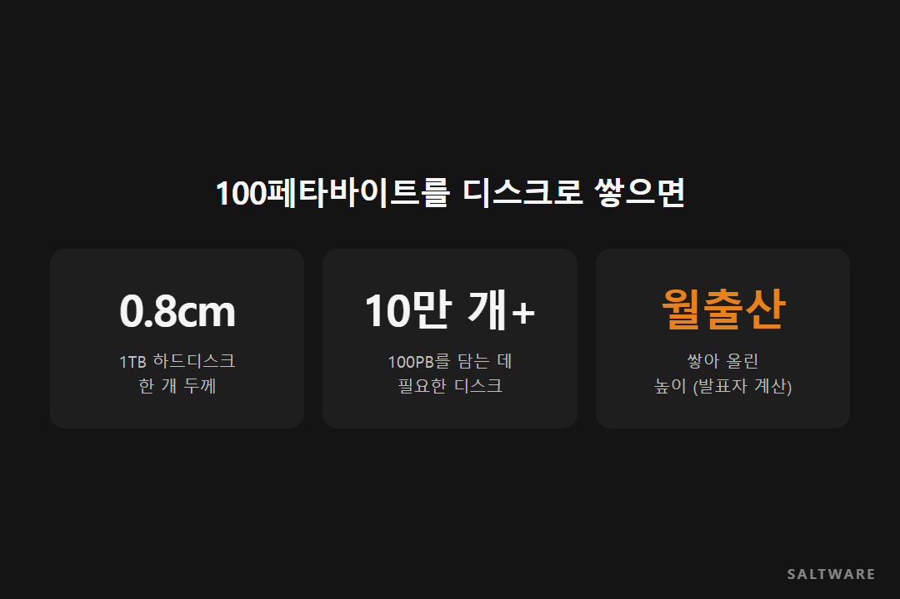
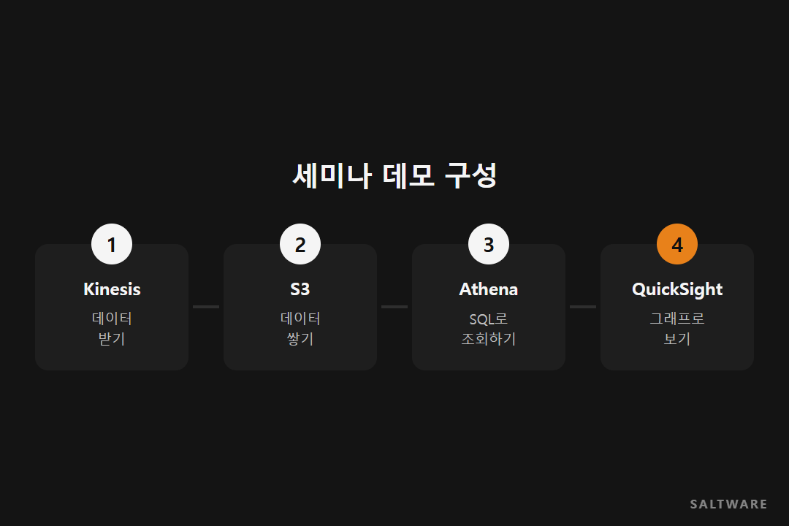
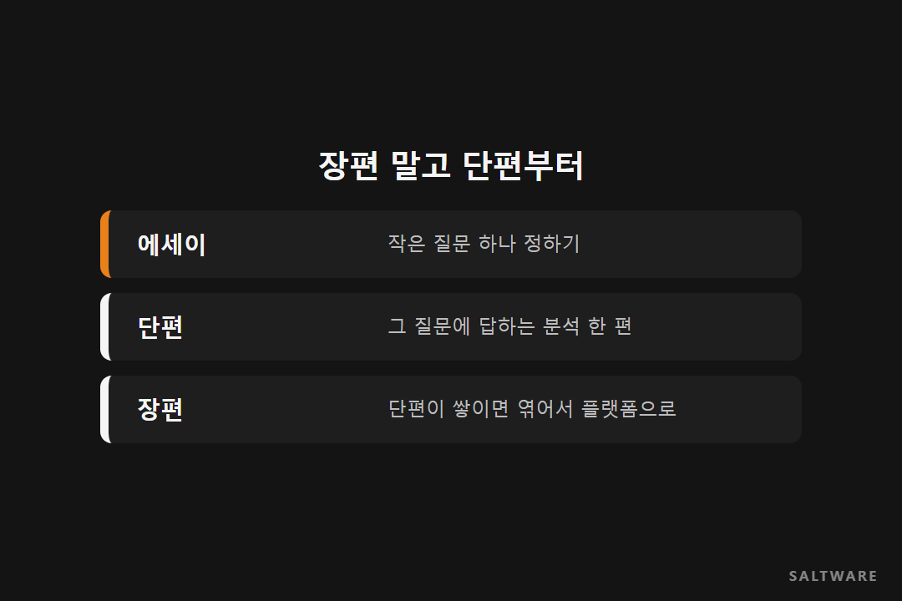

1TB 하드디스크 하나의 두께는 0.8cm 정도입니다. 100페타바이트를 담으려면 이 디스크가 10만 개 넘게 필요합니다. 솔트웨어 함인용 실장이 금융 클라우드 세미나에서 이걸 직접 쌓아 보는 계산을 했는데, 전남 영암의 월출산 높이쯤 된다고 합니다.

이 정도 데이터를 회사 전산실에 두는 건 공간으로도 전기료로도 쉽지 않습니다. 빅데이터 이야기가 나오면 클라우드가 꼭 같이 따라오는 이유입니다.

그런데 현장에서 더 자주 듣는 고민은 크기가 아닙니다. **"그래서 우리는 이걸로 뭘 해야 하죠?"**입니다. 이번 [데이터 노트]는 빅데이터 분석을 어디서 시작하면 좋을지에 대한 이야기입니다.

## 모으고, 담고, 읽는다

데이터 일은 결국 세 단계입니다. 수집, 저장, 분석.

수집에서 중요한 건 많이 모으는 게 아니라 잘 모으는 겁니다. IT에서 오래된 말로 "쓰레기를 넣으면 쓰레기가 나온다"고 하죠. 어떤 데이터를 어떤 형태로 받을지 먼저 정해야 뒤가 편합니다.

저장은 나눠서 담을 수 있어야 합니다. 한 대의 큰 서버에 다 넣는 대신 여러 곳에 나눠 담고 나눠 처리하는 구조가 생기면서 빅데이터가 실제로 쓸 만한 것이 됐습니다.

분석은 통계표를 뽑는 일이 아니라, 데이터 속에서 의미를 찾아 가치로 바꾸는 일입니다.

## 데이터는 크기만 다른 게 아닙니다

빅데이터를 설명할 때 흔히 세 가지를 꼽습니다. 크기(볼륨), 속도(벨로시티), 다양성(버라이어티)입니다.

크기는 테라바이트, 페타바이트 같은 양의 문제입니다. 속도는 하루치를 모아 한 번에 처리하는 데이터도 있고, 생기는 순간 바로 처리해야 하는 데이터도 있다는 뜻입니다. 다양성은 표로 깔끔하게 정리된 데이터부터 문서, 로그, 이미지처럼 정리되지 않은 데이터까지 섞여 있다는 뜻이죠.

금융권이라면 이상거래 탐지, 자금세탁방지, 시장 위기관리처럼 이미 하고 있는 업무에 이 세 가지를 더해 볼 수 있습니다.

## 있는 걸 버리지 않아도 됩니다

빅데이터를 하겠다고 기존 데이터웨어하우스를 다 갈아엎을 필요는 없습니다. 지금 있는 데이터웨어하우스와 데이터마트는 그대로 두고, 성격이 다른 데이터를 데이터 레이크에 따로 담은 다음, 필요할 때 둘을 엮어서 보면 됩니다.

세미나에서 보여 준 데모도 이렇게 단순했습니다. Kinesis로 데이터를 받아 S3에 쌓고, Athena로 SQL을 던져 조회하고, QuickSight로 그래프를 그립니다. 서버를 사고 설치하는 단계가 없으니 데이터로 무엇을 할지에만 집중할 수 있습니다.

## 장편 말고 단편부터

함인용 실장은 발표 끝에 무라카미 하루키 이야기를 꺼냈습니다. 하루키는 장편을 바로 쓰지 않는다고 합니다. 먼저 짧은 에세이를 쓰고, 그걸 바탕으로 단편을 여러 편 쓰고, 몇 년이 지나 그 단편들을 엮어 장편을 씁니다.

빅데이터도 비슷합니다. 처음부터 전사 데이터 플랫폼이라는 장편을 쓰려고 하면 막막합니다. 이상거래 하나, 고객 이탈 하나처럼 작은 질문 하나를 골라 단편 한 편을 먼저 써 보는 겁니다. 그런 단편이 쌓이면 나중에 엮을 거리가 생깁니다.

## 정리하며

데이터가 산처럼 쌓여도 시작은 질문 하나면 됩니다. 수집, 저장, 분석의 순서를 지키고, 있는 시스템은 살리면서, 작은 과제부터 하나씩 끝내 보세요.

다음 [데이터 노트]에서는 생기는 순간 바로 처리해야 하는 실시간 데이터를 다루겠습니다.

#빅데이터분석시작 #데이터수집저장분석 #금융빅데이터 #데이터레이크 #솔트웨어

참고한 영상
- 솔트웨어 세미나, AWS 금융 클라우드 도입 현황 살펴보기 (함인용 실장, 공중기 매니저): https://www.youtube.com/watch?v=R0zLDexN5D4
