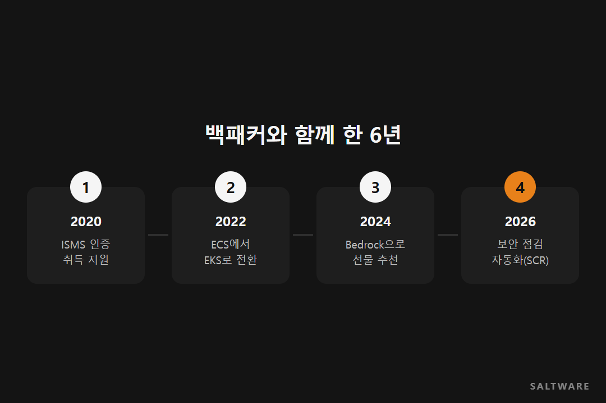
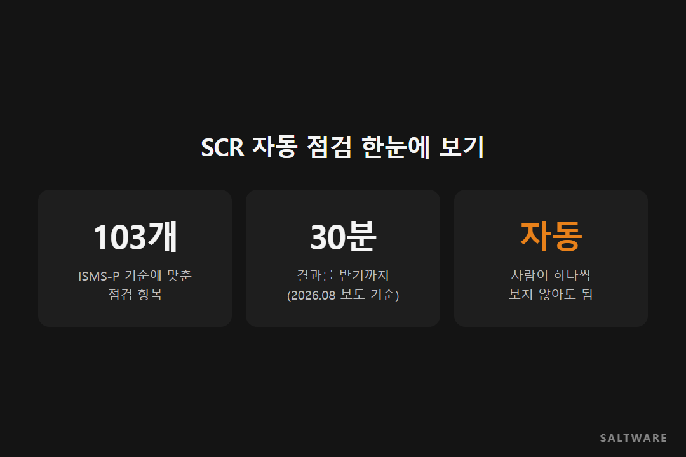

# [고객 사례] 백패커(아이디어스) · 쇼핑몰이 커질 때마다 함께 바꾼 것들

핸드메이드 마켓 아이디어스를 운영하는 백패커는 솔트웨어와 오래 일한 고객사입니다. 2020년 보안 인증부터 2026년 보안 점검 자동화까지, 서비스가 커질 때마다 새로 생긴 숙제를 하나씩 같이 풀었습니다.

이번 고객 사례는 한 프로젝트가 아니라 6년에 걸친 흐름을 따라가 봅니다. 쇼핑몰이 자라면서 인프라에 어떤 일이 생기는지 보기 좋은 사례라서요.

## 2020년, 이용자가 늘자 인증이 숙제가 됐습니다

쇼핑몰 이용자가 일정 규모를 넘으면 정보보호 관리체계(ISMS) 인증을 받아야 합니다. 법 기준은 전년도 말 기준 직전 3개월 동안 하루 평균 이용자 100만 명 이상, 또는 정보통신서비스 부문 전년도 매출 100억 원 이상입니다.

솔트웨어는 2020년 백패커의 ISMS 인증 취득을 지원했습니다. 인증을 받은 뒤에도 해마다 다시 심사를 받습니다. 그래서 처음부터 AWS 설정을 인증 기준에 맞게 잡아 두는 게 이후 운영을 편하게 만듭니다.

## 2022년, 서비스 바탕을 EKS로 옮겼습니다

다음 숙제는 서비스의 바탕이었습니다. 백패커는 컨테이너를 Amazon ECS로 운영하고 있었는데, 서비스가 커지면서 더 유연하게 다룰 수 있는 쿠버네티스 기반의 Amazon EKS로 옮기기로 했습니다. 솔트웨어가 이 전환을 함께 했습니다.

쿠버네티스는 컨테이너를 다루는 사실상의 표준이라 쓸 수 있는 도구와 사람이 많습니다. 대신 처음 세팅과 운영이 까다로워서, 옮기는 동안 서비스가 멈추지 않게 하는 게 가장 신경 쓰이는 부분입니다.

## 2024년, 선물 추천에 생성형 AI를 붙였습니다

아이디어스에는 선물을 고르는 사람이 많습니다. 솔트웨어는 선물 추천 기능에 Amazon Bedrock을 붙여, 기념일과 받는 사람에 어울리는 테마 이름을 자동으로 만들게 했습니다.

AI가 이름만 잘 짓는다고 되는 일은 아니었습니다. 어떤 테마와 상황이 있을 수 있는지 분류 체계를 먼저 함께 설계했습니다. 분류가 잡혀 있어야 AI가 만든 결과를 실제 상품 목록과 이을 수 있기 때문입니다.

## 2026년, 보안 점검을 사람 손에서 뗐습니다

인증을 유지하려면 AWS 설정을 주기적으로 점검해야 합니다. 계정과 서비스가 늘수록 사람이 하나씩 보기는 어려워집니다.

솔트웨어는 ISMS-P 기준에 맞춘 103개 항목으로 AWS 설정을 자동 점검하는 SCR을 백패커에 공급했습니다. 점검 권한만 설정해 두면 결과를 30분 안팎에 받아 봅니다(2026년 8월 보도 기준).

## 비슷한 회사라면

쇼핑몰이 커지는 길에는 순서가 있습니다. 이용자가 늘면 인증이 붙고, 트래픽이 늘면 인프라를 바꾸고, 그다음엔 데이터와 AI로 서비스를 다듬게 됩니다. 각 단계에서 다음 단계를 미리 생각해 두면 나중에 갈아엎는 일이 줄어듭니다. 지금 우리 서비스가 어느 단계쯤인지부터 짚어 보세요.

#커머스AWS사례 #EKS전환 #ISMS인증 #AmazonBedrock #솔트웨어

참고한 자료
- 솔트웨어 홈페이지, 커머스 산업: https://www.saltware.co.kr/industries/commerce.html
- 정보통신망법 제47조(정보보호 관리체계의 인증): https://www.law.go.kr/법령/정보통신망이용촉진및정보보호등에관한법률
