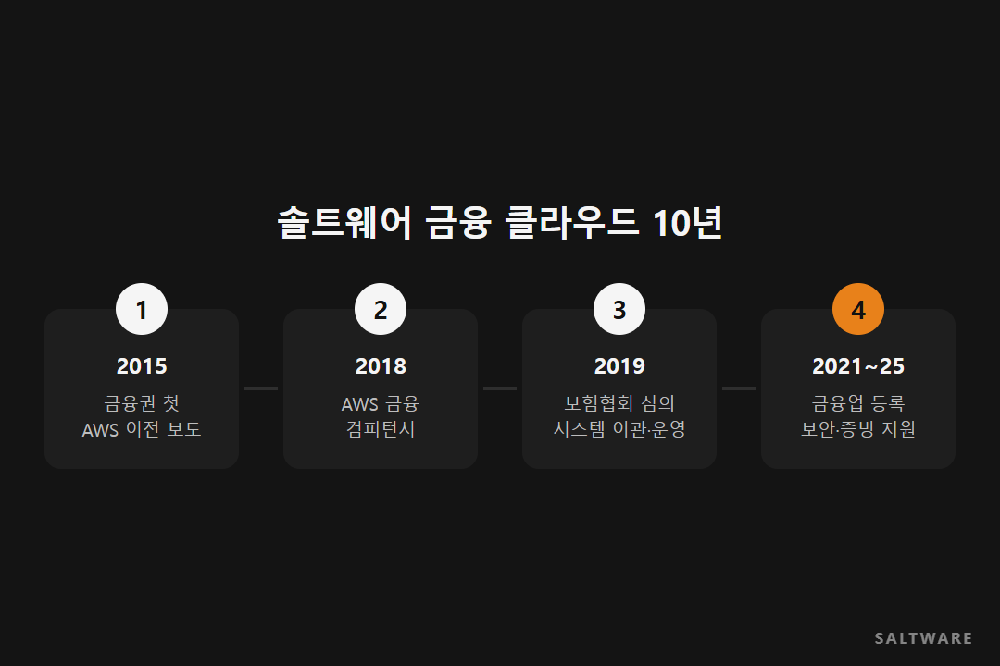
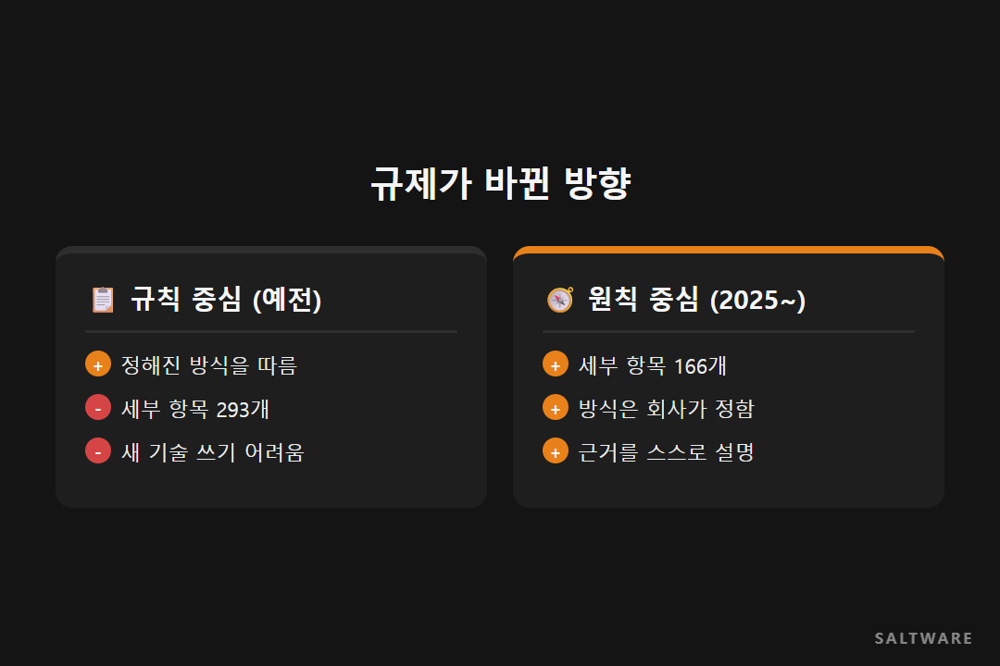

금융회사가 클라우드를 쓴다는 말이 낯설던 때가 있었습니다. 2015년 솔트웨어는 미래에셋자산운용의 웹서버 일부를 AWS로 옮겼습니다. 분석과 설계까지 포함해 한 달 안에 끝낸 일이었고, 전자신문은 이를 국내 금융권 첫 사례로 보도했습니다.

그로부터 10년. 그 사이 금융 규제도 바뀌고, 솔트웨어가 금융권에서 맡는 일의 범위도 넓어졌습니다. 이번 글은 그 흐름을 시간 순서로 따라갑니다.

## 옮기는 일에서 운영하는 일로

첫 이전 이후 금융 쪽 일은 점점 커졌습니다. 2018년에는 금융 산업 클라우드 역량을 AWS가 검증해 주는 AWS Financial Services Competency를 받았습니다.

2019년에는 생명보험협회와 손해보험협회의 광고 심의 시스템을 AWS로 옮겼고, 옮긴 뒤의 운영도 이어서 맡았습니다. 2022년에는 쿼터백자산운용이 개인연금저축 일임서비스를 AWS에 올리는 일을 도왔습니다. 옮기는 일에서 시작해, 그 위에서 서비스가 굴러가는 동안 계속 함께하는 쪽으로 일이 넓어진 셈입니다.

## 금융업 등록, 서류가 곧 설계입니다

새로 금융업을 시작하는 회사에는 등록이라는 큰 관문이 있습니다. 렌딧이 P2P 금융업 등록을 준비할 때 솔트웨어는 보안 아키텍처와 컴플라이언스 대응을 맡았습니다. 아워스포츠네이션이 전자금융업 등록을 준비할 때는 금융 클라우드 이용 보고와 증빙 문서를 함께 준비했습니다.

이 일을 해 보면 알게 되는 게 있습니다. 증빙 서류는 나중에 쓰는 보고서가 아니라 처음 설계할 때 정해지는 것이라는 점입니다. 어떤 기록을 남길지 설계 단계에서 정하지 않으면, 막상 필요할 때 찾을 수 없거나 모으는 데 오래 걸립니다.

## 규칙 중심에서 원칙 중심으로

금융 규제도 크게 달라졌습니다. 금융위원회는 2024년 망분리 개선 로드맵에서 '자율보안·결과책임'을 원칙으로 세웠습니다. 2025년 2월 전자금융감독규정 개정으로 지켜야 할 세부 항목은 293개에서 166개로 줄었습니다.

항목이 줄었다고 할 일이 줄어든 건 아닙니다. 예전에는 정해진 방식을 따르면 됐다면, 이제는 각 회사가 방식을 정하고 왜 그게 안전한지 설명해야 합니다. 쓸 수 있는 클라우드와 AI가 늘어난 만큼 그 근거를 스스로 갖춰야 하는 거죠.

## 비슷한 회사라면

금융권에서 클라우드를 검토한다면 "옮길 수 있나"보다 "옮긴 뒤 무엇을 증명해야 하나"를 먼저 정리해 보세요. 감사와 보고에 필요한 기록을 설계 단계에 넣어 두면 이전도 운영도 훨씬 수월해집니다.

#금융클라우드사례 #금융클라우드이전 #전자금융업등록 #AWS #솔트웨어

참고한 자료
- 솔트웨어 홈페이지, 금융 산업: https://www.saltware.co.kr/industries/finance.html
- 금융위원회 보도자료, 전자금융감독규정 일부개정고시안 의결 (2025.02.05): https://www.fsc.go.kr/no010101/83954
