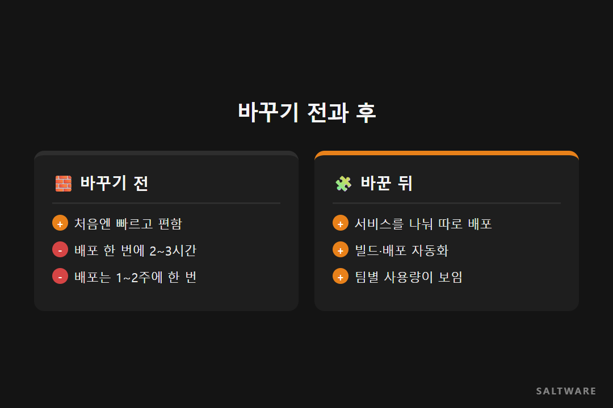
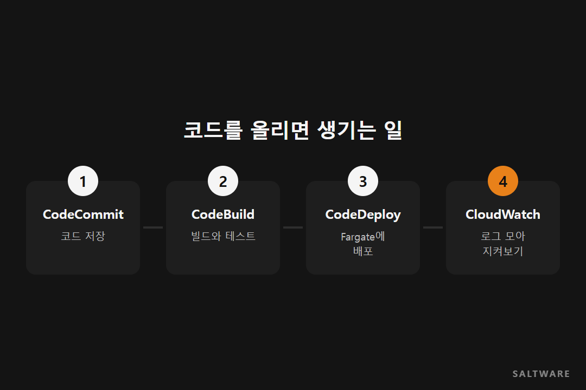
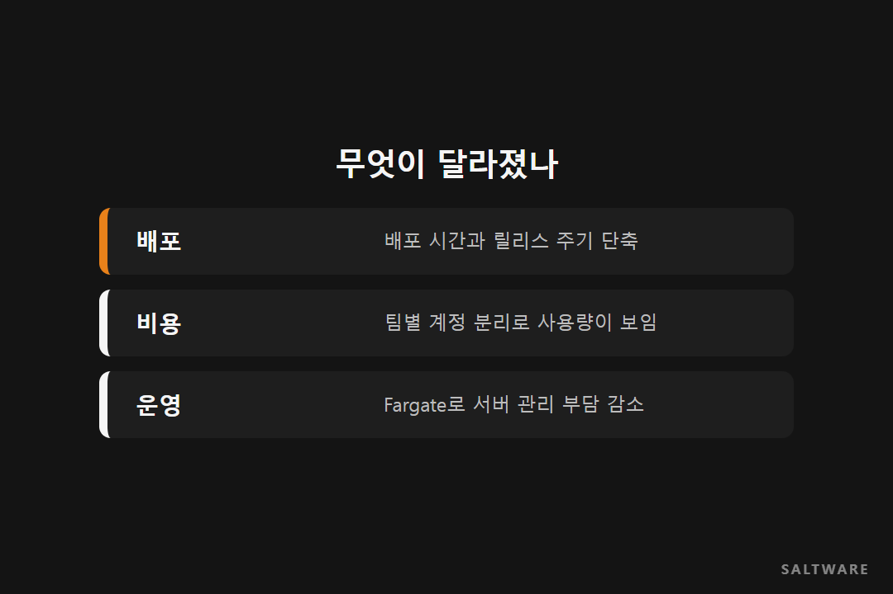

# [고객 사례] 크몽 · 배포 한 번에 2~3시간, 기다리던 개발자들

크몽은 처음부터 AWS 위에서 서비스를 만들었습니다. 시작은 흔한 방식이었습니다. 서비스 전체를 하나의 덩어리로 만드는 모놀리식 구조였죠. 사람이 적고 서비스가 작을 때는 이게 가장 빠르고 편합니다.

문제는 회사가 잘 자라면서 생겼습니다. 인력이 100명 가까이 늘었고, 서비스도 그만큼 커졌습니다. 이 글은 솔트웨어 기술 블로그에 실린 크몽 MSA 전환 사례를 다시 정리한 것입니다.

## 배포 버튼을 누르면 모두가 멈췄습니다

서비스가 한 덩어리이다 보니, 작은 기능 하나를 고쳐도 전체를 다시 배포해야 했습니다. 배포 한 번에 2~3시간이 걸렸고, 관련 개발자들은 그동안 다른 일을 하지 못하고 배포가 끝나기를 기다렸습니다.

그러다 보니 배포는 일주일이나 2주에 한 번으로 미뤄졌습니다. 고칠 건 쌓이는데 내보내는 속도가 따라가지 못하는 상황이었죠.

## 덩어리를 나누고, 배포는 기계에게 맡겼습니다

솔트웨어가 제안한 방향은 두 가지였습니다. 서비스를 작은 단위로 나누는 MSA 전환, 그리고 배포를 사람 손에서 떼어 내는 DevOps 도입입니다.

구조는 2-Tier 웹서비스로 잡았습니다. 각 층을 이중화하고 여러 가용 영역(Multi-AZ)에 나눠 두어 한쪽에 문제가 생겨도 서비스가 멈추지 않게 했습니다. 사용자가 몰리면 AutoScaling이 서버를 늘립니다.

서버 관리 부담은 AWS Fargate로 줄였습니다. 컨테이너만 올리면 그 아래 서버는 AWS가 관리하는 방식이라, 개발자가 서버 패치나 용량 걱정을 덜 수 있습니다.

배포는 AWS Code 시리즈(CodeCommit, CodeBuild, CodeDeploy, CodePipeline)로 자동화했습니다. 코드를 올리면 빌드와 배포가 정해진 순서대로 알아서 돌아갑니다. 로그는 CloudWatch Logs로 모으고 ElasticSearch로 한눈에 보게 했습니다.

## 일하는 방식도 같이 넘겨줬습니다

이 프로젝트는 Agile 방식으로 진행했습니다. 짧은 주기로 만들고 확인하고 고치는 방식입니다. 프로젝트가 끝난 뒤에도 크몽 엔지니어들이 이 방식을 그대로 이어 쓸 수 있게 하자는 목적이었습니다. 시스템만 바꾸고 떠나면 몇 달 뒤 다시 예전처럼 돌아가기 쉽기 때문입니다.

## 무엇이 달라졌나

서비스를 나누면서 배포 시간과 릴리스 주기가 짧아졌습니다. 팀별로 AWS 계정을 나눠 어느 팀이 리소스를 얼마나 쓰는지도 보이게 됐고, 서버 관리 부담이 줄면서 개발·테스트·운영에 드는 지출도 줄었습니다.

다만 얼마나 줄었는지 정확한 숫자는 공개되지 않았습니다.

## 비슷한 회사라면

팀이 커지는데 배포가 점점 느려지고 있다면 한 번 점검해 볼 때입니다. 배포 한 번에 몇 명이 몇 시간을 기다리는지 세어 보면 생각보다 큰 숫자가 나옵니다. 모든 서비스를 한 번에 쪼갤 필요는 없습니다. 가장 자주 고치는 부분부터 떼어 내는 것으로 시작해도 충분합니다.

#MSA전환사례 #CICD구축 #AWSFargate #DevOps #솔트웨어

원문 사례
- 솔트웨어 기술 블로그, AWS CaseStudy-크몽 (2020.02.27): https://fitcloud.github.io/CaseStudy-Kmong-ko/
