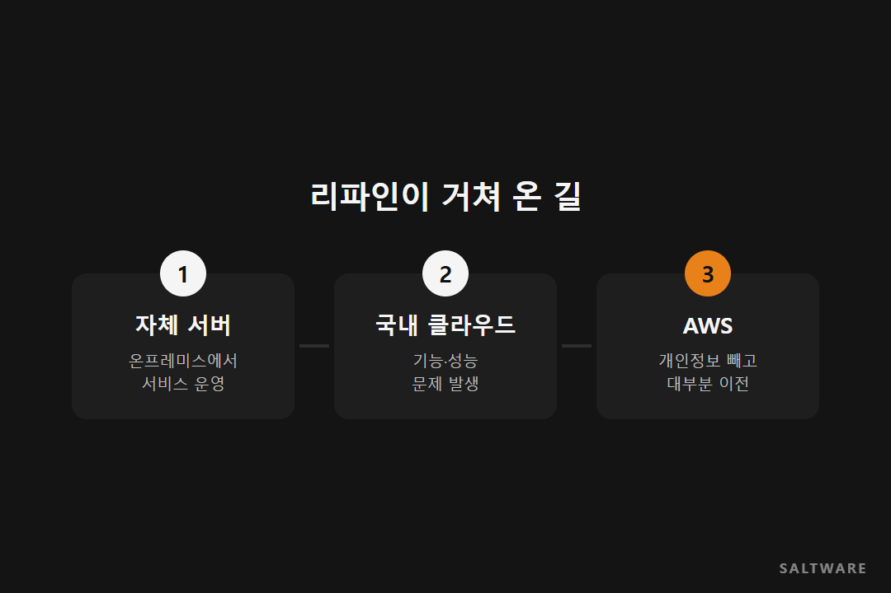
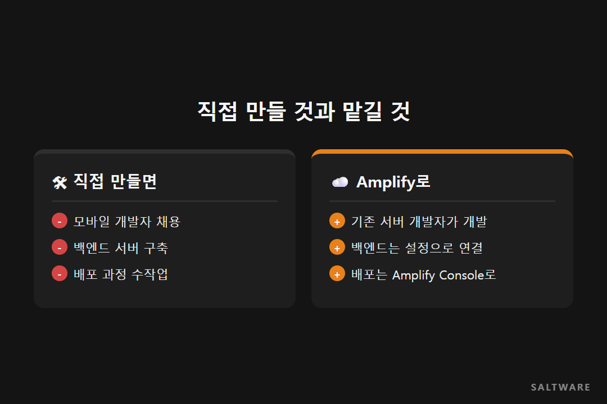

리파인은 주로 B2B 영역의 서버 개발을 해 온 회사입니다. 그런데 새 사업으로 일반 소비자가 쓰는 모바일 서비스를 만들어야 했습니다.

문제는 사람이었습니다. 사내에 모바일 개발자가 없었고, 있는 개발자들도 클라우드 기반 모바일 개발은 해 본 적이 없었습니다. 그런데 기간은 짧았죠. 이 글은 솔트웨어 기술 블로그에 실린 리파인의 AWS Amplify 사례를 다시 정리한 것입니다.

## 클라우드를 한 번 옮기고 다시 옮긴 회사

리파인의 클라우드 이야기는 조금 돌아왔습니다. 처음에는 자체 서버(온프레미스)에서 서비스를 돌리다가 국내 클라우드 업체로 옮겼습니다. 그런데 약속된 기능과 성능에 문제가 있었고, 결국 AWS로 다시 옮겼습니다. 지금은 개인정보 영역을 빼고 대부분의 서비스를 AWS에서 운영합니다.

클라우드를 고를 때 가격표만 보면 이런 일이 생기기 쉽습니다. 옮기는 데 드는 시간과 노력까지 생각하면, 처음 고를 때 필요한 기능이 다 되는지 꼼꼼히 확인하는 편이 결국 싸게 먹힙니다.

## 서버 개발자가 모바일을 만들 수 있게

모바일 개발 방식을 두고 처음에는 다른 회사의 도구도 검토했습니다. 최종적으로는 AWS Amplify를 쓰기로 했습니다. Amplify는 모바일·웹 앱의 백엔드(로그인, 데이터 저장, API 등)를 몇 가지 설정만으로 붙여 주는 서비스입니다. 서버를 직접 만들고 관리할 일이 크게 줄어듭니다.

솔트웨어는 Amplify 기반 개발과 최적화를 맡았고, 서버리스 방식에 맞춰 MSA와 DevOps를 함께 적용했습니다. Amplify Console로 코드 저장(Git, CodeCommit)부터 빌드(CodeBuild), 배포까지 한 흐름으로 묶었습니다. 그 밖에 API Gateway, SQS, CloudFormation, CloudWatch, ElasticSearch를 함께 썼습니다.

## 무엇이 달라졌나

가장 큰 변화는 모바일 개발을 자동화해 기존 서버 개발 인력을 더 폭넓게 쓸 수 있게 된 점입니다. 이 덕분에 비용 절감 효과가 있었습니다.

팀별 AWS 계정과 VPC를 나눠서 어떤 팀이 무엇을 얼마나 쓰는지 보이게 했고, 서비스 그룹이 분리되면서 보안도 나아졌습니다. 배포가 자동화되어 배포 시간과 릴리스 주기도 짧아졌습니다. 다만 얼마나 줄었는지 정확한 숫자는 공개되지 않았습니다.

## 비슷한 회사라면

새 사업은 해야 하는데 그 분야 개발자가 없다면, 사람부터 뽑기 전에 관리형 서비스로 줄일 수 있는 일이 얼마나 되는지 먼저 따져 보세요. 직접 만들어야 하는 부분이 줄어들수록 지금 있는 팀으로 해낼 수 있는 범위가 넓어집니다.

#AWSAmplify사례 #서버리스모바일개발 #클라우드재이전 #MSA #솔트웨어

원문 사례
- 솔트웨어 기술 블로그, AWS CaseStudy-리파인 (2020.03.04): https://fitcloud.github.io/CaseStudy-Refine-ko/
