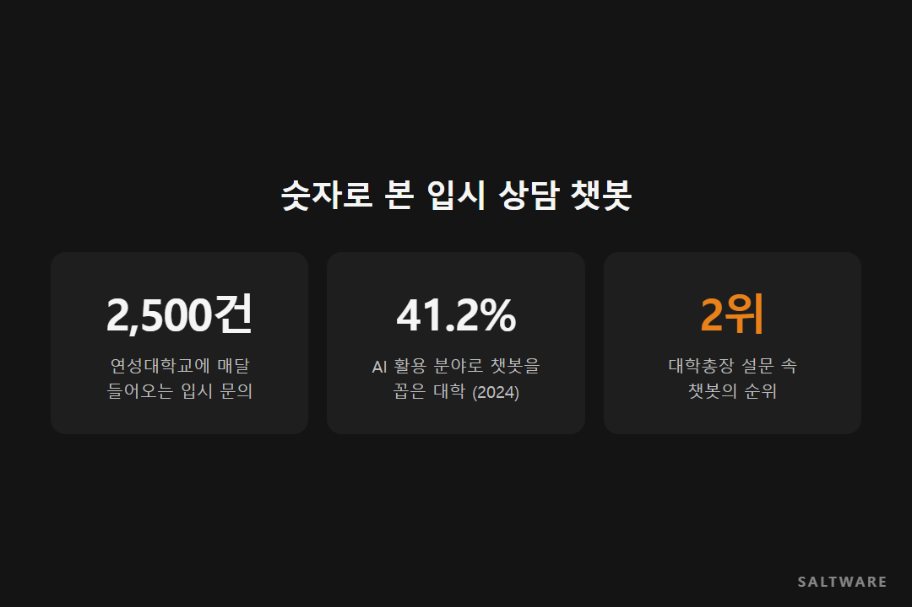
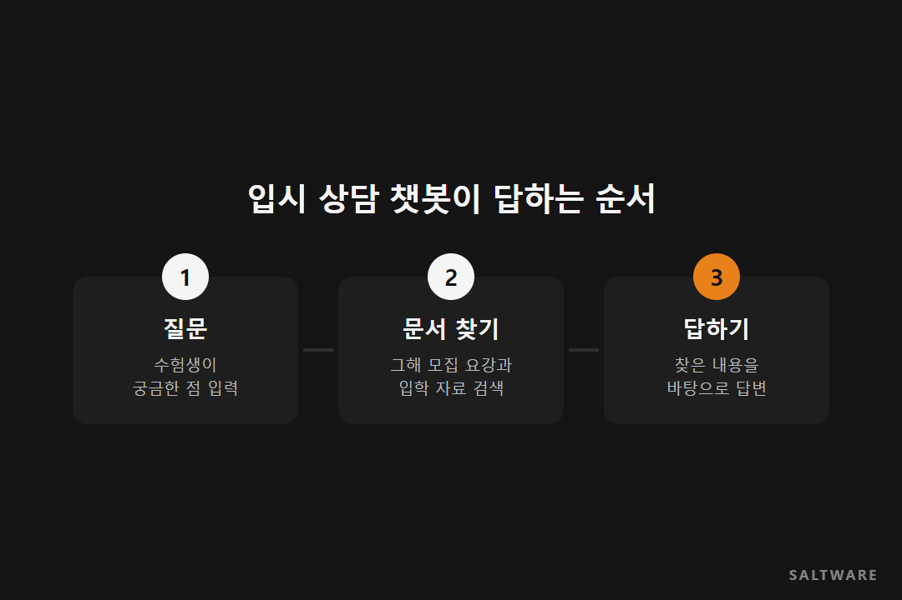

# [고객 사례] 연성대학교 · 한 달 2,500건 입시 문의에 챗봇을 세운 이유

입시철 대학 입학처 전화는 쉴 틈이 없습니다. 연성대학교에는 매달 2,500건 정도의 입시 문의가 들어옵니다. 상당수는 모집 요강을 보면 답이 나오는 질문인데, 그걸 찾아 읽는 일이 수험생에게도 교직원에게도 만만치 않습니다.

솔트웨어는 2025년 연성대학교에 입학전형 상담 챗봇과 교직원용 AI 어시스턴트를 만들었습니다.

## 대학이 AI를 쓰고 싶은 자리

대학들이 생성형 AI를 어디에 쓰고 싶어 하는지 물은 조사가 있습니다. 2024년 한국대학교육협의회의 대학총장 설문에서 챗봇을 꼽은 대학이 41.2%로 두 번째였습니다.

입시 상담은 그중에서도 챗봇이 잘 맞는 자리입니다. 질문이 몰리는 시기가 정해져 있고, 답의 근거가 되는 모집 요강이 분명하게 있기 때문입니다.

## 아무 AI나 붙이면 안 되는 이유

일반 챗봇에게 "우리 학교 수시 지원 자격이 뭐예요?"라고 물으면 그럴듯하지만 틀린 답이 나오기 쉽습니다. 입시 정보는 학교마다, 해마다 다르기 때문입니다. 입시에서 틀린 답은 수험생에게 곧바로 손해가 됩니다.

그래서 이 챗봇은 검색 증강 생성(RAG) 방식으로 만들었습니다. RAG는 AI가 답하기 전에 정해진 문서, 여기서는 그해 모집 요강과 입학 자료를 먼저 찾아 읽고 그 내용을 바탕으로 답하게 하는 방식입니다. 솔트웨어의 사피봇(Sapie Bot)이 그 바탕이 됐습니다.

## 수험생 쪽과 교직원 쪽, 두 개를 만들었습니다

수험생이 쓰는 입학전형 상담 챗봇과 별도로, 교직원이 쓰는 AI 어시스턴트도 함께 만들었습니다. 상담 창구 앞에 선 사람만큼 뒤에서 자료를 찾는 사람도 바쁘기 때문입니다. 같은 자료를 읽는 AI가 양쪽에 있으면 수험생이 받는 답과 교직원이 보는 답이 어긋날 일도 줄어듭니다.

얼마나 많은 문의를 챗봇이 대신 받았는지 같은 숫자는 공개되지 않았습니다. [확인 필요: 공개 가능한 도입 효과 수치가 있으면 추가]

## 비슷한 기관이라면

질문은 많은데 답이 문서에 있는 업무라면 RAG 챗봇을 먼저 검토해 볼 만합니다. 시작 전에 할 일은 하나입니다. AI가 읽을 문서를 최신 상태로 한곳에 모아 두는 것. 챗봇의 정확도는 결국 그 문서의 정확도를 따라갑니다.

#대학입시상담챗봇 #RAG챗봇 #생성형AI교육 #사피봇 #솔트웨어

참고한 자료
- 솔트웨어 홈페이지, 교육 산업: https://www.saltware.co.kr/industries/education.html
