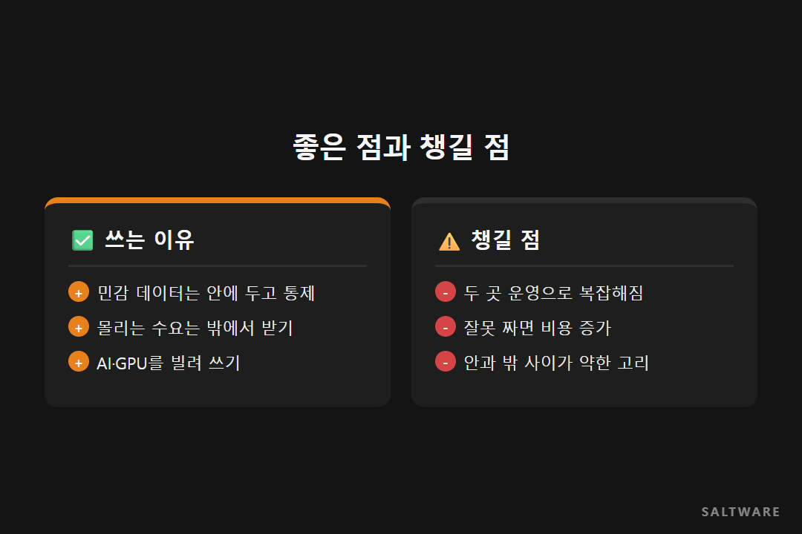
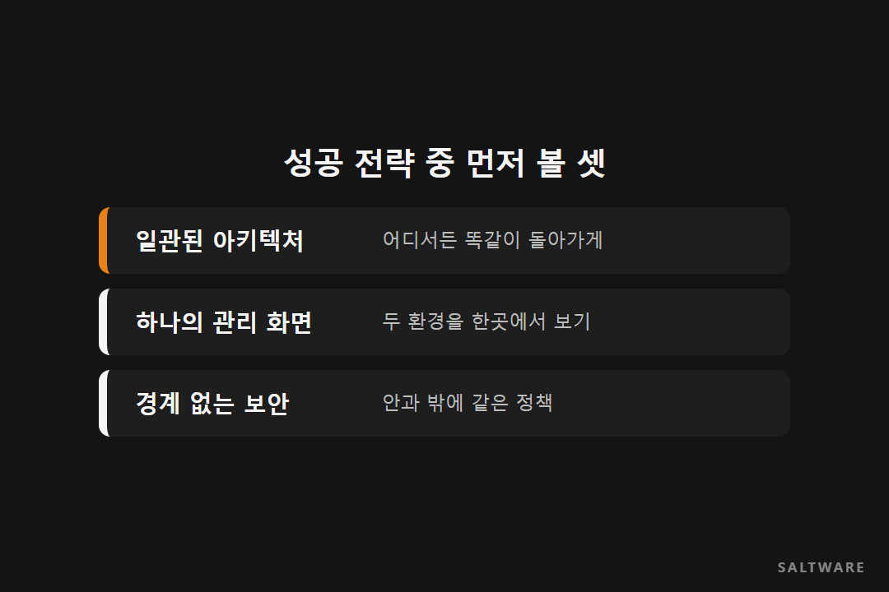

대학 수강신청 날을 떠올려 보세요. 학생 정보와 성적은 학교 밖으로 내보내기 꺼려집니다. 그런데 수강신청 당일 몰리는 접속은 학교 서버만으로 버티기 어렵습니다. 데이터는 안에 두고 싶고, 갑자기 늘어나는 일은 밖에 맡기고 싶은 거죠.

이 고민에 대한 답 중 하나가 하이브리드 클라우드입니다. 솔트웨어 최상철 상무는 2022 교육정보화 컨퍼런스에서 이 주제로 발표했습니다. **하이브리드 클라우드는 새로운 클라우드가 아니라, 이미 있던 두 가지를 하나처럼 쓰는 방식입니다.** 이번 [데이터 노트]는 그 발표 내용을 정리한 것입니다.

## 안과 밖을 하나처럼 씁니다

회사가 직접 갖춘 프라이빗 클라우드와 AWS 같은 퍼블릭 클라우드를 묶어 하나의 서비스처럼 운영하는 것이 하이브리드 클라우드입니다. 예전에는 같은 종류의 클라우드를 여러 개 섞어 쓰는 멀티 클라우드라는 말이 더 흔했는데, 요즘 하이브리드가 주목받는 이유는 데이터의 안정성과 규제 때문입니다.

## 쓰는 이유는 여섯 가지입니다

첫째, 유연성입니다. 아키텍처를 일관되게 짜 두면 어느 쪽에든 쉽게 배포할 수 있습니다. 둘째, 갑자기 늘어난 수요를 퍼블릭으로 받아 낼 수 있습니다. 프라이빗은 장비를 사고 설치하는 데 시간이 걸리니까요. 셋째, 일부 작업을 밖으로 옮겨 서버 비용을 줄일 여지가 생깁니다.

발표에서 가장 힘주어 말한 건 넷째였습니다. 개인정보나 학생 정보, 금융 정보처럼 민감한 데이터는 안에 두고 통제력을 지키면서, 그 데이터를 연결해 쓸 수 있다는 점입니다. 다섯째, GPU 같은 장비를 직접 사지 않고도 퍼블릭의 AI·빅데이터 서비스를 골라 쓸 수 있습니다. 여섯째, 한쪽이 멈췄을 때 다른 쪽으로 버틸 수 있습니다.

## 대신 챙길 것도 늘어납니다

좋은 점만 있는 건 아닙니다. 두 환경을 함께 돌리니 운영이 복잡해집니다. 제대로 설계하지 않으면 자원이 겹쳐 오히려 비용이 늘 수도 있습니다.

보안도 조심해야 합니다. 안과 밖의 보안 수준이 다르면 그 사이를 오가는 길목이 약한 고리가 됩니다. 수강신청 예시라면 학교 안의 성적 데이터와 밖의 애플리케이션을 잇는 네트워크와 보안 정책이 공격받기 쉬운 지점입니다. 시장에 업체가 많아져 무엇을 골라야 할지 어려워진다는 점도 꼽혔습니다.

## 성공하려면 일곱 가지를 맞춥니다

발표에서는 일곱 가지 전략을 제시했습니다. 어디서든 돌아가는 일관된 아키텍처, 두 환경을 함께 움직이는 오케스트레이션, 한 화면에서 보는 단순한 관리 도구, 양쪽에 똑같이 적용되는 정책, 경계 없이 감싸는 보안, 서로 다른 API를 이어 주는 호환성, 사람 실수를 줄이는 인프라 자동화입니다.

## 솔트웨어가 고객사와 일하며 보는 것

솔트웨어는 퍼블릭과 프라이빗 클라우드를 모두 다뤄 온 경험을 바탕으로, 두 환경을 하나로 관리하는 파트너 관리형 방식을 지향합니다. 컨설팅과 구축, 데이터 이전, 규제 대응, 유지보수까지 이어서 맡습니다. 공공 쪽에서는 레드햇 기반 플랫폼 구축과 기술지원도 하고 있습니다.

## 정리하며

하이브리드 클라우드는 민감한 데이터는 지키고 필요한 힘은 빌려 쓰는 방식입니다. 대신 두 집 살림이 되는 만큼 아키텍처, 보안, 관리 도구를 처음부터 하나로 맞춰야 합니다.

참고로 이 발표는 2022년에 나온 것이라 발표 속 시장 전망 수치는 이번 글에 옮기지 않았습니다.

#하이브리드클라우드 #프라이빗클라우드 #클라우드전략 #클라우드보안 #솔트웨어

참고한 자료
- 2022 교육정보화 컨퍼런스, 하이브리드 클라우드 시장 전망과 전략 (솔트웨어 최상철 상무): https://www.youtube.com/watch?v=vxyBNW_9908
- 솔트웨어 홈페이지, 공공 산업(레드햇 사업): https://www.saltware.co.kr/industries/public.html
