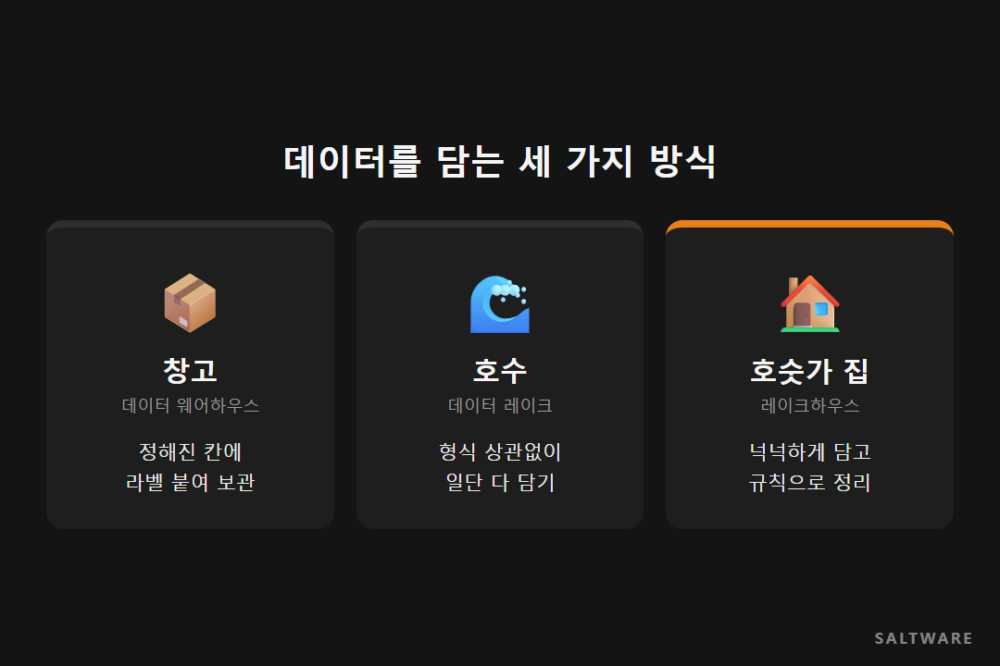
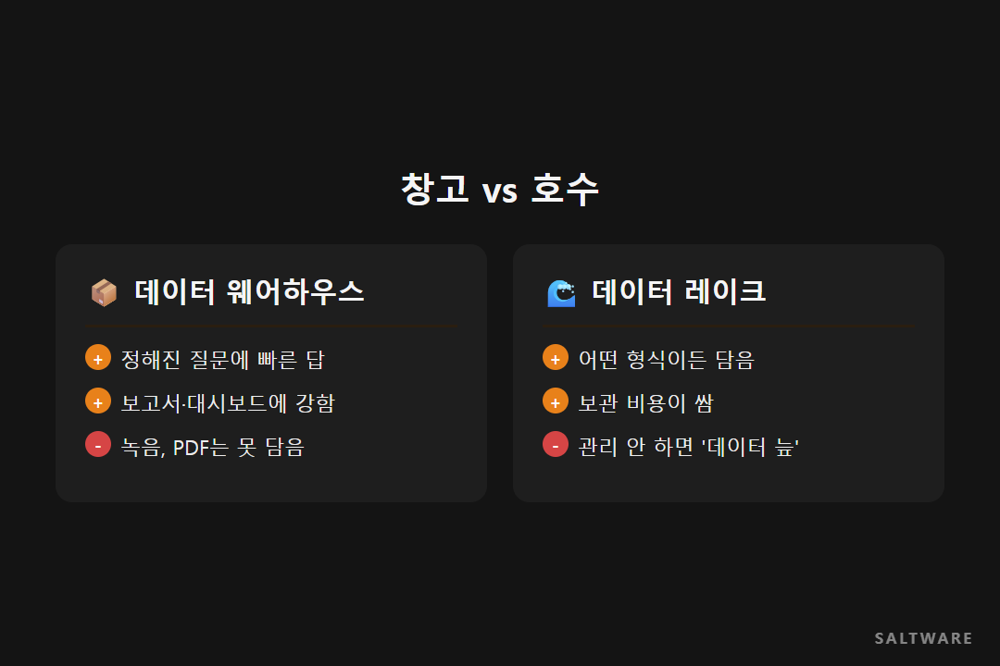
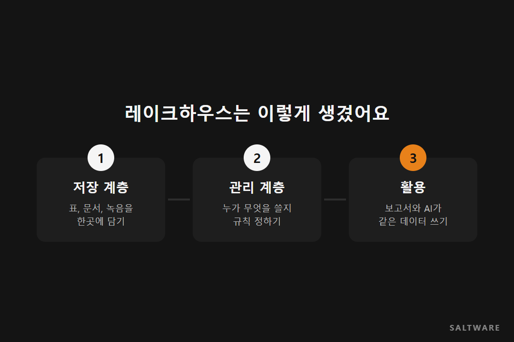
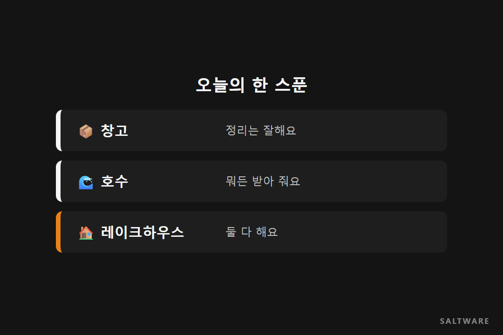

# 레이크하우스란? 창고와 호수 사이, 데이터가 사는 집 🏠

안녕하세요, 솔트웨어 블로그 '데이터 한 스푼'입니다. 오늘 고른 단어는 레이크하우스예요.

회의에서 "우리도 레이크하우스로 가야 하지 않을까요?"라는 말이 나왔는데 고개만 끄덕이고 넘어간 적 있으신가요? 이 글은 레이크하우스가 무엇이고, 기존 방식과 뭐가 다른지 창고와 호수에 빗대어 풀어 봅니다. 다 읽고 나면 다음 회의에서 한 마디쯤은 보태실 수 있을 거예요.

## 창고는 깔끔한데 좀 답답해요

먼저 데이터 웨어하우스부터 볼게요. 이름 그대로 창고입니다. 데이터가 들어오면 정해진 선반, 정해진 칸에 라벨을 붙여 넣어요.

덕분에 꺼낼 때는 편합니다. "지난달 서울 지역 매출"처럼 정해진 질문에는 빠르고 정확하게 답이 나오거든요. 보고서와 대시보드가 주로 이 창고에서 데이터를 가져가요.

대신 선반 모양에 안 맞는 물건은 들어갈 자리가 없어요. 고객 상담 녹음, 계약서 PDF, 공장 센서 기록 같은 것들이죠.

## 호수는 뭐든 받아 주지만 금방 탁해져요

그래서 나온 게 데이터 레이크예요. 형식을 가리지 않고 일단 다 부어 넣는 커다란 호수입니다. 표든 영상이든 녹음 파일이든 다 받아 주고, 보관 비용도 싼 편이에요.

문제는 관리예요. 들어오는 속도를 정리가 못 따라가면 같은 고객 데이터가 세 군데 들어가 있는데 숫자가 서로 다르고, 누가 언제 넣었는지도 안 남게 됩니다. 이렇게 쓸모를 잃은 호수를 업계에서는 **데이터 늪**이라고 불러요.

## 그럼 레이크하우스는 뭐가 다른데요?

호숫가에 집을 지었다고 생각하시면 됩니다. 데이터는 호수처럼 형식 상관없이 넉넉하게 담아 두고, 그 위에 창고처럼 라벨과 규칙을 얹는 구조예요.

Databricks 공식 문서도 레이크하우스를 레이크와 웨어하우스의 장점을 합친 데이터 관리 방식으로 설명합니다. 데이터를 담는 저장 계층 위에 누가 어떤 데이터를 쓸 수 있는지 관리하는 계층을 따로 둬서, 호수가 늪으로 변하지 않게 붙잡아 두는 거죠.

그러면 일하는 방식이 달라져요. 매출 담당자는 지금처럼 정리된 표를 꺼내 보고, 데이터 분석가는 같은 곳에서 상담 기록까지 엮어 분석합니다. 데이터를 두 군데 따로 관리하지 않으니 "어느 숫자가 맞아요?"라는 질문도 줄어들고요.

## AI 얘기할 때 레이크하우스가 꼭 나오는 이유

생성형 AI가 회사 일을 도우려면 숫자로 된 표와 문서, 대화 기록을 한꺼번에 봐야 합니다. 창고만 있으면 문서가 없고, 호수만 있으면 어떤 숫자가 정확한지 AI도 헷갈려요.

둘 다 한곳에, 그것도 정리된 상태로 있어야 AI가 엉뚱한 답을 덜 하게 됩니다. 레이크하우스는 보고서용 분석과 머신러닝을 같은 데이터 위에서 돌릴 수 있게 만든 구조라서, AI 도입 계획에 자주 함께 등장해요.

## 솔트웨어는 이렇게 하고 있어요

솔트웨어는 Databricks로 레이크하우스를 구축하는 일을 돕고 있어요. 처음부터 데이터를 전부 옮기기 부담스러운 회사라면, Starburst로 지금 있는 시스템은 그대로 두고 여러 곳을 한 번에 조회하는 데서 시작하는 방법도 있습니다. 다만 이 방식은 시스템 사이 거리가 멀면 조회가 느려질 수 있어서, 자주 쓰는 데이터부터 단계적으로 모으는 식으로 섞어 쓰는 경우가 많아요.

[확인 필요: 실제 레이크하우스 구축 사례나 고객 업종 한 줄]

## 오늘의 한 스푼

**창고는 정리, 호수는 포용, 레이크하우스는 둘 다.** 다음 회의에서 레이크하우스 이야기가 나오면 "우리 데이터는 지금 창고에 있나요, 호수에 있나요?"부터 물어보세요. 대화가 훨씬 구체적으로 바뀔 거예요.

다음 '데이터 한 스푼'에서는 AI가 사내 문서를 찾아 읽는 방식, RAG를 다룹니다.

#레이크하우스 #데이터웨어하우스 #데이터레이크 #데이터플랫폼 #솔트웨어

참고한 자료
- Databricks 공식 문서, What is a data lakehouse: https://docs.databricks.com/lakehouse
- Databricks 블로그, Lakehouse FAQ: https://www.databricks.com/it/blog/2021/08/30/frequently-asked-questions-about-the-data-lakehouse.html
- Atlan, Data Lake vs Data Swamp: https://atlan.com/data-lake-vs-data-swamp/
- Starburst 소개 자료: https://www.starburst.io/resources/starburst-brochure
