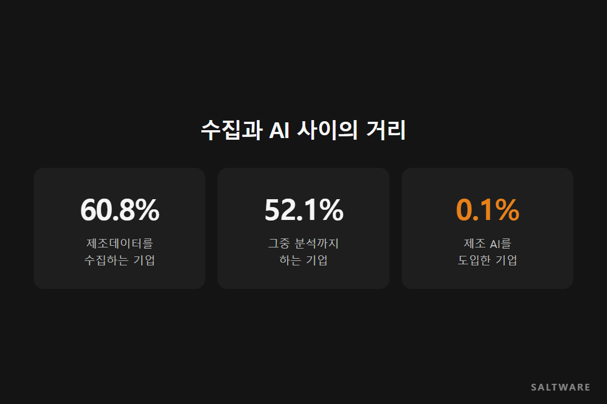
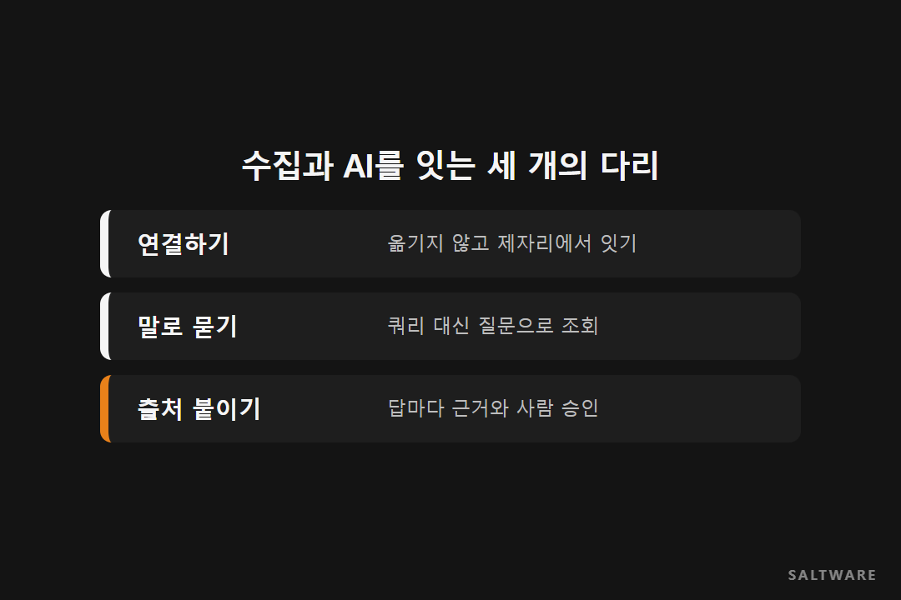

공장을 가진 중소·중견 제조기업 가운데 제조 데이터를 모으는 곳은 60.8%입니다. 그런데 제조 AI를 도입한 곳은 0.1%입니다. 중소벤처기업부가 2025년에 낸 스마트제조혁신 실태조사 결과입니다.

열 곳 중 여섯 곳이 데이터를 모으는데, 천 곳 중 한 곳만 AI로 읽는다는 뜻입니다. **데이터가 없어서가 아닙니다. 모은 데이터와 AI 사이에 다리가 없어서입니다.** 이번 [데이터 노트]는 그 다리 이야기입니다.

## 모으는 것과 쓰는 것은 다른 일입니다

같은 조사에서 데이터를 모으는 기업 가운데 분석까지 하는 곳은 52.1%였습니다. 반쯤은 모아 두기만 한다는 얘기죠. 데이터·AI 전담 인력을 둔 곳은 0.8%였습니다.

현장에서 보면 이유가 짐작됩니다. 생산 실적은 생산 DB에, 원가는 ERP에, 공정 기준은 문서함에, 설계는 도면 파일에 있습니다. 질문 하나에 답하려면 이 네 곳을 다 열어야 하는데, 그걸 할 줄 아는 사람은 회사에 한두 명뿐입니다.

## 다리 하나, 옮기지 말고 연결하기

모든 데이터를 한곳으로 옮기는 건 시간도 돈도 많이 듭니다. 옮기는 동안 공장은 계속 돌아가야 하고요. 그래서 먼저 생각할 방법은 데이터를 제자리에 둔 채 연결하는 것입니다. 생산 DB와 ERP, 문서와 도면이 각자 자리에 있어도 한 번에 찾아볼 수 있게 이어 두는 겁니다.

## 다리 둘, 쿼리 대신 말로 묻기

연결해도 SQL을 짜야 한다면 여전히 한두 명만 쓸 수 있습니다. 현장 담당자가 "지난달 라인별 생산 실적을 공정 기준과 같이 정리해 줘"라고 말로 물으면, AI가 그 말을 쿼리로 바꿔 여러 DB를 조회하고 관련 문서까지 찾아오게 해야 합니다.

## 다리 셋, 답마다 출처 붙이기

AI가 숫자를 내놓았을 때 "이거 어디서 나온 거지?"를 확인할 수 없으면 아무도 그 숫자로 결정하지 않습니다. 답마다 어떤 데이터에서, 어느 기준일로, 어떤 계산으로 나왔는지 붙어 있어야 합니다. 그리고 사람이 확인하고 승인하는 단계를 남겨 둬야 합니다.

## 솔트웨어가 고객사와 일하며 보는 것

솔트웨어는 제조·방산 현장에서 이기종 데이터베이스 교차 분석, ERP 연계 자연어 분석, 도면 기반 유사 검색, 공정 지식 질의응답을 구축해 왔습니다. 그 경험을 담아 2026년 9월 Sapie-ADP를 정식 출시했습니다. 데이터를 옮기지 않고 연결하고, 말로 물으면 에이전트가 찾아 주고, 답마다 출처가 붙고, 기존 시스템 권한을 그대로 따릅니다. 외부와 끊긴 사내망에서는 회사 안의 AI 모델로 쓸 수 있습니다.

## 정리하며

제조 데이터를 AI로 넘기려면 연결, 질문, 확인이라는 세 다리가 필요합니다. 전사 플랫폼부터 꿈꾸기보다 질문 하나를 골라 이 세 다리를 놓아 보세요.

다음 [데이터 노트]에서는 연결한 데이터에 누가 접근할 수 있는지, 권한을 정리하는 이야기를 다루겠습니다.

#제조AI도입 #제조데이터분석 #자연어데이터질의 #SapieADP #솔트웨어

참고한 자료
- 솔트웨어 홈페이지, 제조 산업: https://www.saltware.co.kr/industries/manufacturing.html
- 솔트웨어 홈페이지, Sapie-ADP: https://www.saltware.co.kr/business/data-ai.html
- 중소벤처기업부, 스마트제조혁신 실태조사 (2025.04.28): https://www.mss.go.kr
