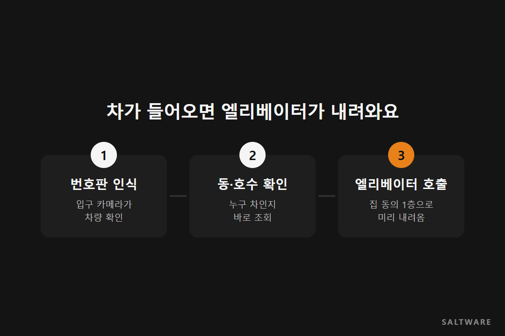
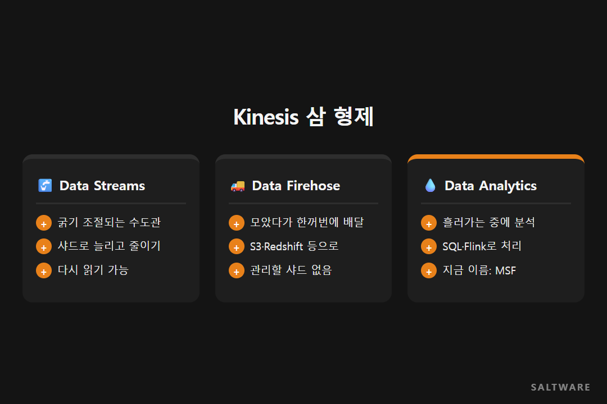

# 실시간 데이터는 어떻게 흐를까? 수도관으로 보는 Kinesis 🚰

안녕하세요, 솔트웨어 블로그 '데이터 한 스푼'입니다. 오늘 고른 단어는 실시간 데이터 처리예요.

퇴근길에 아파트 주차장으로 들어서는데, 집에 올라가려고 보니 엘리베이터가 이미 1층에 내려와 있습니다. 솔트웨어 웨비나에서 정영우 SA가 소개한 국내 한 건설사의 사례인데요. 입구 카메라가 번호판을 읽는 순간 그 차가 몇 동 몇 호인지 알아보고, 엘리베이터를 미리 불러 두는 방식이에요.

이게 되려면 번호판 데이터가 생기자마자 바로 처리돼야 합니다. 하루 모았다가 밤에 분석하면 의미가 없죠. 오늘은 이렇게 생기는 순간 처리하는 데이터가 어떤 길로 흐르는지 수도관에 빗대어 정리해 볼게요.

## 언제 처리하느냐에 따라 할 수 있는 일이 달라요

데이터는 매 순간 생깁니다. 이걸 언제 들여다보느냐에 따라 쓸모가 바뀌어요. 생기는 순간 보면 바로 행동할 수 있고, 1분 뒤에 보면 일이 벌어진 다음 대응하게 되고, 하루치를 모아 보면 지난 흐름을 분석하게 됩니다.

셋 다 필요하지만, 엘리베이터처럼 기다려 주지 않는 일에는 실시간 처리가 맞아요.

## 수도관이 필요한 이유

실시간 데이터의 길을 수도 시설로 생각해 보면 쉬워요. 물이 나오는 곳(소스)이 있고, 물을 나르는 관(스트림)이 있고, 물을 쓰는 곳(컨슈머)이 있죠. 소스는 앱 로그, IoT 센서, 웹사이트 클릭 기록 같은 것들이에요. 데이터를 보내는 쪽을 프로듀서, 받아 쓰는 쪽을 컨슈머라고 부릅니다.

이 관을 회사가 직접 깔 수도 있어요. Kafka 같은 오픈소스로 스트림 서버를 세우는 거죠. 그런데 직접 하면 일이 많습니다. 서버를 세우고, 데이터가 늘면 관을 굵게 바꾸고, 한 대가 고장 나도 멈추지 않게 이중으로 깔고, 다른 서비스와 잇는 코드도 따로 짜야 해요. 정영우 SA는 그래서 관리형 서비스인 Amazon Kinesis를 쓴다고 설명했어요.

## Kinesis 삼 형제, 뭐가 다른데요?

웨비나에서는 Kinesis를 세 가지로 나눠 설명했어요.

첫째는 Kinesis Data Streams예요. 굵기를 조절할 수 있는 수도관이에요. 샤드라는 단위로 관을 늘리고 줄이고, 흘러간 데이터를 일정 기간 담아 두었다가 다시 읽을 수도 있어요.

둘째는 Kinesis Data Firehose예요. 물탱크가 달린 배달 트럭에 가까워요. 들어온 데이터를 잠깐 모았다가 S3, Redshift, OpenSearch 같은 목적지로 한꺼번에 실어 보냅니다. 관 굵기를 따로 신경 쓸 필요가 없고, 가는 길에 Lambda로 데이터 모양을 바꿀 수도 있어요. 지금은 이름에서 Kinesis가 빠져 Amazon Data Firehose로 불려요.

셋째는 Kinesis Data Analytics예요. 관 중간에 단 정수기 같은 역할이에요. 흘러가는 데이터를 어딘가에 저장하지 않고 그 자리에서 SQL이나 Apache Flink로 분석해요. 예를 들어 5분마다 센서 평균 온도를 보고 기준을 넘으면 바로 알림을 보내는 식이죠. 이 서비스는 2023년에 Amazon Managed Service for Apache Flink로 이름이 바뀌었어요.

## 솔트웨어는 이렇게 하고 있어요

솔트웨어는 웨비나에서 Kinesis 세 서비스를 직접 만들어 보는 실습을 함께 진행했어요. 실시간 처리가 필요한 고객사라면 어떤 데이터를 어떤 속도로 받아야 하는지부터 같이 정리하고, 관을 직접 깔지 관리형 서비스로 갈지 고르는 데서 시작합니다.

[확인 필요: 실시간 데이터 처리를 도입한 실제 고객 사례 한 줄]

## 오늘의 한 스푼

**Streams는 수도관, Firehose는 배달 트럭, Analytics는 관 중간의 정수기.** 실시간 처리를 고민한다면 먼저 "이 데이터를 몇 초 안에 써야 하나?"부터 물어보세요. 답이 나오면 어떤 길을 깔지도 정해집니다.

다음 '데이터 한 스푼'에서는 AI가 사내 문서를 찾아 읽는 방식, RAG를 다룹니다.

#실시간데이터처리 #AmazonKinesis #스트리밍데이터 #IoT #솔트웨어

참고한 자료
- 솔트웨어 웨비나, AWS를 활용한 Data Analytics (정영우 SA): https://www.youtube.com/watch?v=0iuvRXVC8OA
- AWS, Amazon Managed Service for Apache Flink: https://aws.amazon.com/managed-service-apache-flink/
