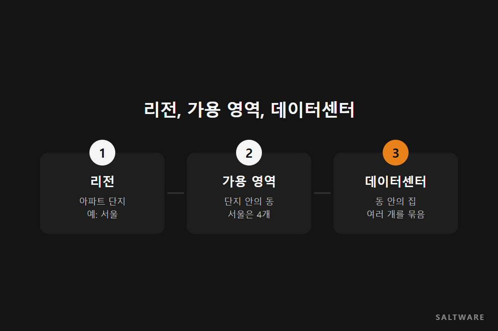
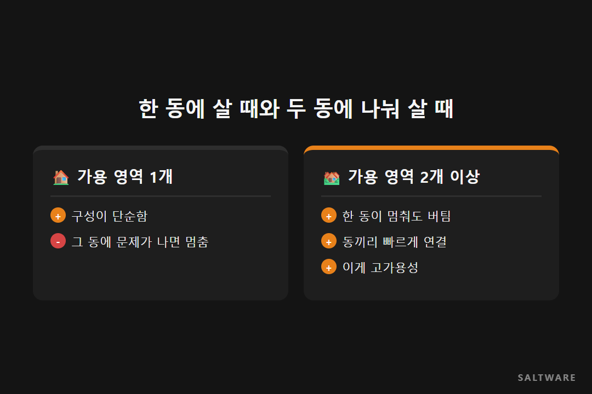

안녕하세요, 솔트웨어 블로그 '데이터 한 스푼'입니다. 오늘 고른 단어는 리전과 가용 영역이에요.

AWS 콘솔을 처음 열면 오른쪽 위에 '서울', '도쿄', '버지니아 북부' 같은 이름이 보입니다. 서버를 하나 만들려고 해도 "가용 영역을 선택하세요"라는 말이 나오고요. 솔트웨어가 AWS와 함께 연 '클라우드 왕초보 맞춤 교육' 웨비나에서도 가장 먼저 다룬 게 이 두 단어였어요. 오늘은 아파트 단지에 빗대어 풀어 볼게요.

## 리전은 아파트 단지예요

리전은 지역적으로 떨어져 있는 큰 구역이에요. 아파트로 치면 하나의 단지입니다. 서울에 단지가 하나, 도쿄에 하나, 미국 동부에도 여럿 있는 식이죠. 한국에는 서울 리전이 하나 있어요.

어느 단지에 살지 고르는 기준은 사는 사람, 그러니까 서비스 이용자가 어디 있느냐예요. 한국 고객이 쓰는 서비스라면 서울 리전에 두는 게 가장 빠릅니다. 개인정보처럼 나라 밖으로 나가면 안 되는 데이터가 있다면 리전 선택은 규정 문제이기도 해요.

## 가용 영역은 단지 안의 동이에요

단지 안에는 여러 동이 있어요. 이게 가용 영역(AZ)이에요. 가용 영역 하나는 데이터센터 여러 개를 묶은 구역이고, 서울 리전에는 가용 영역이 4개 있어요.

중요한 건 동마다 전기와 수도, 그러니까 전원과 네트워크가 따로 들어온다는 점이에요. 한 동에 정전이 나도 옆 동은 멀쩡하죠. 대신 같은 단지 안이라 동끼리는 빠른 길로 이어져 있어서 서로 주고받는 속도는 빨라요.

## 그래서 두 동에 나눠 살아요

서비스를 한 가용 영역에만 두면, 그 동에 문제가 생겼을 때 서비스도 같이 멈춰요. 그래서 중요한 서비스는 두 개 이상의 가용 영역에 나눠 둡니다. 이걸 고가용성이라고 불러요. 앞서 소개한 [고객 사례] 크몽도 각 층을 여러 가용 영역(Multi-AZ)에 나눠 두는 구조로 바꿨어요.

## 단지 밖에도 정류장이 있어요

리전과 가용 영역 말고도 알아 두면 좋은 게 두 가지 더 있어요. 엣지 로케이션은 단지 밖 곳곳에 있는 택배 보관함 같은 곳이에요. 자주 찾는 이미지나 영상을 사용자 가까운 곳에 미리 두어 빨리 보여 주는 CDN 서비스(CloudFront)의 접속 지점이죠. Direct Connect는 우리 회사 건물과 단지를 잇는 전용 도로예요. 인터넷을 거치지 않고 전용선으로 AWS와 연결합니다.

## 오늘의 한 스푼

**리전은 단지, 가용 영역은 동, 중요한 건 두 동에 나눠 살기.** 처음 서버를 만들 때 "어느 단지에, 몇 개 동에 나눠 둘까?"부터 정하면 나머지 설정이 훨씬 쉽게 정리돼요.

다음 '데이터 한 스푼'에서는 AI가 사내 문서를 찾아 읽는 방식, RAG를 다룹니다.

#리전가용영역 #AWS기초 #고가용성 #클라우드입문 #솔트웨어

참고한 영상
- 솔트웨어 웨비나, AWS X 솔트웨어 클라우드 왕초보 맞춤 교육 입문반: https://www.youtube.com/watch?v=u06P6t3cgYU
- AWS 공식 문서, 리전과 가용 영역: https://aws.amazon.com/ko/about-aws/global-infrastructure/regions_az/
